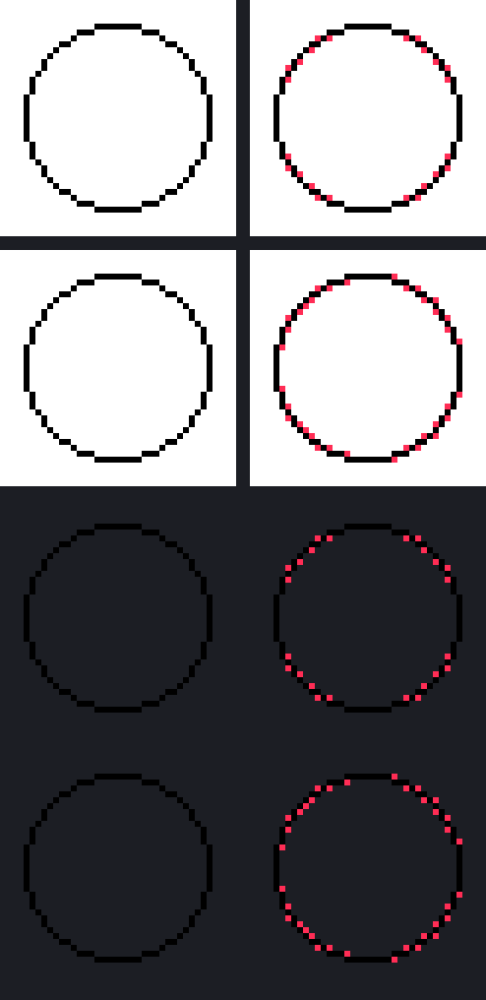

# Diagonal Gap Closer

A small post-process for **pixel-art line art**.

## The problem it solves

When you draw a thin 1-pixel curve, the curve is really a chain of pixels, and every
diagonal step in that chain produces a *diagonal-only contact*: two pixels that touch
by their corners but share no edge.

```text
  . # .        # = line pixel
  # . .        the two # touch diagonally, but there is no edge between them
  . . .
```

Those contacts are what make a curve look broken, let a flood fill leak out of your
line art, or cause the line to break up when it is scaled down or exported.

## What the tool does

For every pair of line pixels that touch **only** diagonally, the tool checks the two
pixels that would bridge them:

```text
  A # .     # and # touch diagonally
  # B .     A and B are the two possible bridge pixels - both are empty
  . . .
```

If both bridge pixels are empty, the gap is real, and the tool **adds one extra pixel**
— the bridge pixel that best continues the local line, judged by how many line pixels
surround it. The new pixel copies the most common line colour nearby, so your outline
colour is preserved.

Every decision is made from the original image, so added pixels never cascade into each
other within a single run.



On the 40×40 circle above: **conservative** adds 24 pixels, **aggressive** adds 36.

## Two ways to run it

### 1. Browser — no install

Open **`diagonal-gap-closer.html`** in any browser. That's it: no Python, no server,
no build step.

1. Drop a PNG in, choose one, or paste it with **Ctrl+V**.
2. Pick how the background is detected, and pick a strength.
3. Added pixels are drawn in red; toggle **Result / Original** to compare.
4. Choose a save scale and hit **Download PNG** (or right-click the preview →
   *Save image as…*).

Nothing is uploaded — the whole thing runs on the page. Output is always lossless PNG.

### 2. Python CLI

```bash
pip install pillow

python diagonal_gap_closer.py input.png output.png
```

Common options:

```bash
# force the background mode instead of auto-detecting
python diagonal_gap_closer.py input.png output.png --background transparent
python diagonal_gap_closer.py input.png output.png --background white

# fill ambiguous gaps too (see below - you probably want this)
python diagonal_gap_closer.py input.png output.png --strength aggressive
```

| Option | Default | Meaning |
|---|---|---|
| `--background` | `auto` | `auto`, `transparent`, or `white`. Auto picks transparent if any pixel has alpha < 255, otherwise white. |
| `--white-threshold` | `245` | RGB at or above this value counts as background when the background is white. |
| `--strength` | `conservative` | `conservative` or `aggressive` (see below). |

## Conservative vs aggressive — read this

This is the setting that matters most.

- **Conservative** only fills a gap when one bridge pixel clearly has more line around
  it than the other. It refuses to guess.
- **Aggressive** also fills the ambiguous ties.

The catch: on a **plain diagonal line** (and on the very common shallow curve that
alternates one step across and one step down), *both* bridge pixels almost always have
exactly equal support. So **conservative adds nothing at all** to those — it is
effectively a no-op on the lines you most want fixed.

If your goal is "close the gaps in my thin curves", use **aggressive**.

## Caveats

- It is a heuristic post-process, not a semantic line-art repair. **Work on a copy** and
  look at the result — it deliberately adds pixels, and in aggressive mode it will
  occasionally add one you didn't want.
- It only ever adds pixels; it never removes or moves one.
- Transparent backgrounds are preserved. If you export to a format without alpha, flatten
  first.

## Files

| File | Purpose |
|---|---|
| `diagonal-gap-closer.html` | The browser tool. Single file, no dependencies. |
| `diagonal_gap_closer.py` | The original command-line version (needs Pillow). |
| `diagonal-gap-closer-demo.png` | Before/after example on a 1-pixel circle. |

## License

MIT.
